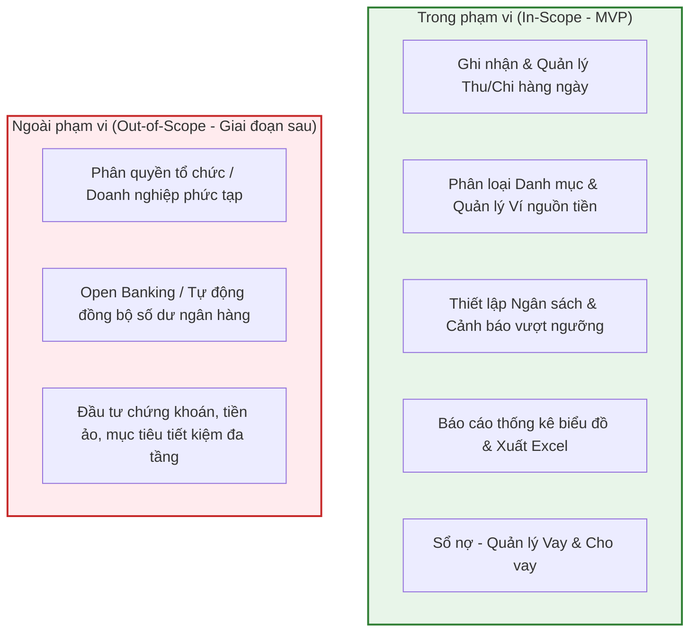
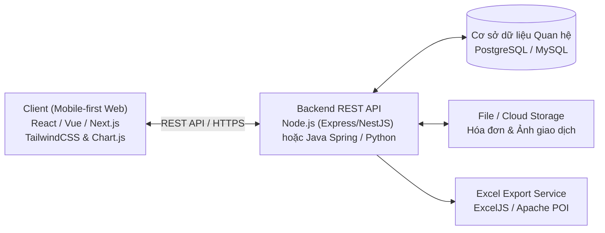
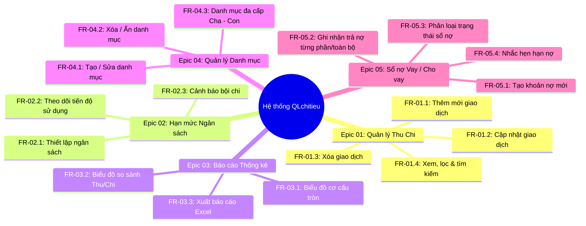
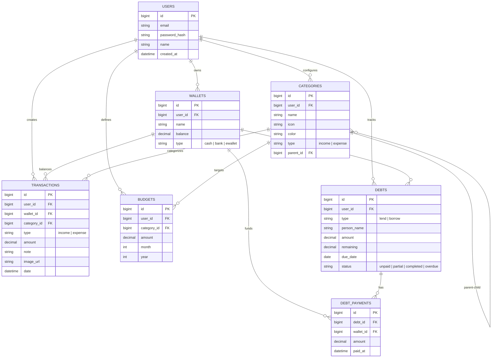

# 💰 QLchitieu - Hệ Thống Quản Lý Chi Tiêu Cá Nhân

> **Dự án:** Quản lý Chi tiêu Cá nhân (Personal Expense Management)  
> **Repository:** [https://github.com/Giang-49/QLchitieu](https://github.com/Giang-49/QLchitieu)  
> **Phiên bản:** v1.0.0 (MVP)  
> **Tiêu chuẩn tài liệu:** Tuân thủ chuẩn IEEE 830 (Software Requirements Specifications)

---

## 📌 1. Giới thiệu tổng quan (Introduction)

### 1.1. Mục đích
**QLchitieu** là giải pháp phần mềm hỗ trợ người dùng cá nhân theo dõi, kiểm soát và tối ưu hóa tài chính hàng ngày một cách khoa học, trực quan và thuận tiện. Dự án đóng vai trò là cơ sở thống nhất giữa các bên liên quan (**Product Owner / BA, Developer, Tester, Stakeholder**) trong quá trình thiết kế, phát triển theo phương pháp Agile/Scrum, kiểm thử và nghiệm thu.

### 1.2. Mục tiêu kinh doanh
- **Kiểm soát dòng tiền:** Giúp người dùng nắm bắt chính xác dòng tiền vào/ra theo thời gian thực.
- **Kỷ luật tài chính:** Thiết lập hạn mức ngân sách cho từng danh mục, tự động cảnh báo nguy cơ bội chi.
- **Quản lý công nợ minh bạch:** Ghi nhận chi tiết các khoản vay/cho vay, theo dõi tiến độ hoàn trả và nhắc hẹn tự động.
- **Báo cáo trực quan:** Trực quan hóa số liệu qua biểu đồ cơ cấu và xu hướng thu chi, hỗ trợ ra quyết định tài chính cá nhân.

### 1.3. Phạm vi dự án (Scope)



### 1.4. Đối tượng sử dụng

| Vai trò | Trách nhiệm & Mục đích sử dụng |
| :--- | :--- |
| **Người dùng cuối (End-user)** | Cá nhân muốn theo dõi thu nhập, chi tiêu, quản lý ngân sách và sổ nợ hàng ngày. |
| **BA / Scrum Master** | Phân tích yêu cầu, quản lý Product Backlog, User Story Map và nghiệm thu tính năng. |
| **Developer (FE/BE)** | Thiết kế kiến trúc, phát triển RESTful API và giao diện Mobile-first Responsive. |
| **Tester / QA** | Thiết kế test scenario, viết test case chi tiết và kiểm thử chức năng/phi chức năng. |

---

## 🏗️ 2. Kiến trúc & Công nghệ đề xuất (Tech Stack & Architecture)



- **Mô hình kiến trúc:** Client - Server qua giao thức RESTful API.
- **Frontend:** Responsive Web ưu tiên **Mobile-First**, tông màu chủ đạo Xanh dương (`#1F4E79`) & Trắng, hỗ trợ Dark Mode. Thư viện biểu đồ: **Chart.js** hoặc **ApexCharts**.
- **Backend:** Kiến trúc hướng dịch vụ (Service-Oriented), xác thực người dùng qua JWT/OAuth2.
- **Database:** RDBMS (MySQL 8.0+ hoặc PostgreSQL 14+).

---

## 🎯 3. Các Epic & Yêu cầu chức năng (Functional Requirements)

### 📊 Bảng tổng hợp các Epic chức năng



---

### Chi tiết các Epic

#### 💳 Epic 01: Quản lý giao dịch thu chi
- **FR-01.1 - Thêm mới giao dịch:** Cho phép người dùng nhập giao dịch Thu/Chi với: Số tiền (> 0), Loại, Danh mục, Ví thanh toán, Ngày, Ghi chú, Ảnh hóa đơn đính kèm. Tự động cập nhật số dư ví tức thời.
- **FR-01.2 - Cập nhật giao dịch:** Hỗ trợ chỉnh sửa thông tin giao dịch đã tạo. Hệ thống tự động tính chênh lệch số tiền và điều chỉnh số dư ví chính xác.
- **FR-01.3 - Xóa giao dịch:** Xóa giao dịch kèm cảnh báo xác nhận; hoàn trả lại số dư ví ban đầu.
- **FR-01.4 - Xem, lọc & tìm kiếm:** Dòng thời gian (Timeline) sắp xếp giảm dần theo thời gian; hỗ trợ lọc theo ví, danh mục, khoảng ngày và tìm kiếm từ khóa trong ghi chú.

#### 🎯 Epic 02: Quản lý hạn mức ngân sách
- **FR-02.1 - Thiết lập hạn mức:** Đặt định mức chi tiêu tối đa cho từng danh mục theo tháng (Số tiền hạn mức > 0).
- **FR-02.2 - Theo dõi tiến độ:** Thanh tiến độ trực quan hiển thị tỷ lệ % đã chi:
  - 🟢 `< 70%`: Mức an toàn (Xanh lá).
  - 🟡 `70% - 99%`: Cảnh báo tiệm cận (Vàng cam).
  - 🔴 `≥ 100%`: Vượt ngân sách (Đỏ cảnh báo).
- **FR-02.3 - Cảnh báo vượt ngưỡng:** Tự động kích hoạt thông báo trên giao diện và đẩy Push Notification khi đạt mốc **80%** và **100%** hạn mức.

#### 📈 Epic 03: Báo cáo & Thống kê chi tiêu
- **FR-03.1 - Biểu đồ tròn cơ cấu chi tiêu:** Hiển thị tỷ trọng chi tiêu của các danh mục theo khoảng thời gian tùy chọn (Tuần/Tháng/Năm).
- **FR-03.2 - Biểu đồ so sánh Thu vs Chi:** Biểu đồ cột thể hiện tương quan dòng tiền vào và ra theo từng tháng trong năm, hỗ trợ tooltip chi tiết khi tương tác.
- **FR-03.3 - Xuất báo cáo Excel:** Xuất file `.xlsx` danh sách giao dịch với đầy đủ các trường: Ngày, Loại, Danh mục, Số tiền, Ví nguồn, Ghi chú.

#### 📂 Epic 04: Quản lý danh mục thu chi
- **FR-04.1 - Tạo & Sửa danh mục:** Đặt tên, chọn icon biểu tượng, gán nhãn màu sắc và phân loại (Thu nhập / Chi phí).
- **FR-04.2 - Xóa / Ẩn danh mục:** Đảm bảo toàn vẹn dữ liệu: Khi xóa danh mục đã có giao dịch, bắt buộc người dùng chọn danh mục thay thế để chuyển đổi.
- **FR-04.3 - Danh mục Cha - Con:** Hỗ trợ phân cấp cây danh mục để quản lý chi tiêu sâu (VD: `Ăn uống` -> `Cà phê`, `Ăn ngoài`, `Đi chợ`).

#### 🤝 Epic 05: Quản lý hồ sơ vay & Sổ nợ
- **FR-05.1 - Tạo khoản nợ:** Ghi nhận khoản `Vay` (mình đi vay) hoặc `Cho vay` (người khác vay mình): Người liên quan, Số tiền, Hạn trả, Ví tác động, Ghi chú.
- **FR-05.2 - Ghi nhận thanh toán:** Hỗ trợ trả nợ một phần hoặc tất toán toàn bộ. Tự động trừ số nợ còn lại và cập nhật ví; không cho phép thanh toán vượt số tiền nợ.
- **FR-05.3 - Phân loại trạng thái:** Quản lý theo các tab: *Chưa thanh toán*, *Đã hoàn tất*, *Quá hạn*.
- **FR-05.4 - Nhắc hẹn:** Tự động gửi thông báo khi đến ngày đáo hạn trả nợ hoặc đòi nợ.

---

## 🗄️ 4. Thiết kế Cơ sở Dữ liệu (Database Schema)



---

## ⚡ 5. Yêu cầu phi chức năng (Non-Functional Requirements)

| Mã số | Phân loại | Tiêu chuẩn chất lượng yêu cầu |
| :--- | :--- | :--- |
| **NFR-01** | **Hiệu năng (Performance)** | Thời gian tải danh sách giao dịch ≤ 2.0 giây với 1.000 bản ghi dữ liệu. |
| **NFR-02** | **Độ sẵn sàng (Availability)** | Thời gian hoạt động (Uptime) đạt ≥ 99% trong giờ sử dụng thông thường. |
| **NFR-03** | **Bảo mật (Security)** | Mật khẩu băm an toàn (Argon2/Bcrypt); toàn bộ API yêu cầu xác thực JWT qua HTTPS; cô lập dữ liệu người dùng tuyệt đối. |
| **NFR-04** | **Giao diện (UI/UX)** | Thiết kế Mobile-First, chuẩn Responsive trên thiết bị di động, tablet và desktop. |
| **NFR-05** | **Tương thích (Compatibility)** | Hoạt động mượt mà trên phiên bản mới nhất của Chrome, Safari, Firefox, Edge. |
| **NFR-06** | **Khả năng mở rộng (Scalability)** | Thiết kế sẵn sàng cho kiến trúc Multi-wallet, Multi-currency và liên kết tài khoản gia đình. |
| **NFR-07** | **Khả dụng (Usability)** | Giao diện thân thiện, tối giản, người dùng làm quen và thao tác thành thạo trong vòng < 15 phút. |

---

## 📖 6. Danh mục tài liệu tham khảo & Tri thức chi tiết

Tất cả các tài liệu kỹ thuật chi tiết đã được chuẩn hóa và lưu trữ tại thư mục [`docs/`](./docs/):

1. 📄 [**Đặc tả Yêu cầu Phần mềm (SRS Chi tiết)**](./docs/SRS_Dac_Ta_Yeu_Cau.md) - Đặc tả hoàn chỉnh theo chuẩn IEEE 830.
2. 🗄️ [**Thiết kế Cơ sở Dữ liệu & DDL Scripts**](./docs/Thiet_Ke_CSDL.md) - Mô tả chi tiết schema, chỉ mục (indexes), ràng buộc và mã SQL khởi tạo.
3. 📋 [**Đặc tả Use Case & Luồng Nghiệp vụ**](./docs/Dac_Ta_Use_Cases.md) - Phân tích chi tiết 5 use case trọng tâm, luồng chính, luồng phụ và biệt lệ.
4. 🚀 [**Đặc tả API & Kiến trúc Hệ thống**](./docs/Kien_Truc_Va_API.md) - Thiết kế endpoint RESTful API, mã trạng thái và mẫu Request/Response.

---

## 🛠️ 7. Hướng dẫn phát triển (Development Guide)

### 7.1. Cấu trúc thư mục dự án

```text
QLchitieu/
├── docs/                      # Tài liệu tri thức dự án
│   ├── SRS_Dac_Ta_Yeu_Cau.md  # Tài liệu SRS đầy đủ
│   ├── Thiet_Ke_CSDL.md       # Thiết kế CSDL & Script SQL
│   ├── Dac_Ta_Use_Cases.md    # Chi tiết đặc tả Use Case
│   └── Kien_Truc_Va_API.md    # Đặc tả REST API & Kiến trúc
├── src/                       # Mã nguồn dự án (sau khi triển khai)
│   ├── backend/               # Server API service
│   └── frontend/              # Ứng dụng Web / Mobile
├── database/                  # File migration & seed dữ liệu
│   └── schema.sql             # SQL Script tạo bảng
└── README.md                  # Tài liệu tổng quan dự án
```

### 7.2. Lộ trình triển khai (Roadmap)
- [x] **Sprint 0:** Thu thập yêu cầu, hoàn thiện tài liệu SRS, thiết kế CSDL và kiến trúc API.
- [ ] **Sprint 1 (Core):** Xác thực tài khoản, Quản lý Ví và Quản lý Danh mục (Epic 04).
- [ ] **Sprint 2 (Transactions):** Quản lý Giao dịch Thu/Chi (Epic 01) & Tự động tính toán số dư.
- [ ] **Sprint 3 (Budget & Debts):** Quản lý Ngân sách (Epic 02) & Quản lý Sổ nợ (Epic 05).
- [ ] **Sprint 4 (Analytics & Export):** Báo cáo thống kê biểu đồ & Xuất dữ liệu Excel (Epic 03).
- [ ] **Sprint 5 (Hardening):** Kiểm thử chấp nhận người dùng (UAT), tối ưu hiệu năng và triển khai.

---
*Tài liệu được biên soạn và bảo trì bởi đội ngũ dự án QLchitieu.*
