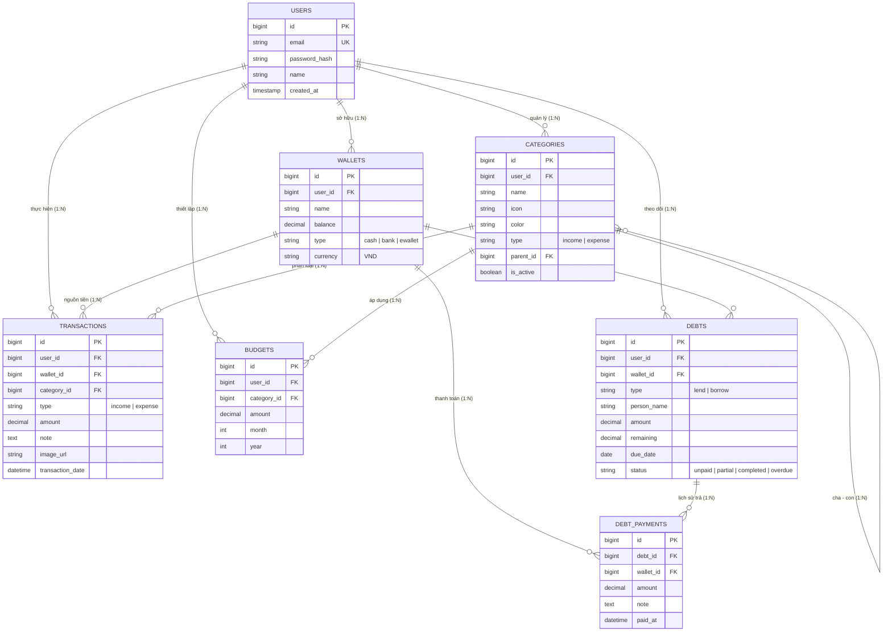

# 💰 QLchitieu - Hệ Thống Quản Lý Chi Tiêu Cá Nhân

> **Dự án:** Quản lý Chi tiêu Cá nhân (Personal Expense Management)  
> **Repository GitHub:** [https://github.com/Giang-49/QLchitieu](https://github.com/Giang-49/QLchitieu)  
> **Google Sheets Kế hoạch & Backlog:** [N4_QLchitieu Google Sheet](https://docs.google.com/spreadsheets/d/1F6wNzzoMZXcfSOnE1PY7pOnpFfUA0xy1r9P4A_vtToU/edit?usp=sharing)  
> **Tiêu chuẩn tài liệu:** IEEE Std 830-1998 & Agile Scrum Framework  
> **Phiên bản:** v1.0.0 (MVP)

---

## 📌 1. Giới thiệu tổng quan (Introduction)

### 1.1. Mục đích
**QLchitieu** là phần mềm hỗ trợ người dùng cá nhân theo dõi, kiểm soát và tối ưu hóa tài chính hàng ngày một cách khoa học, trực quan và thuận tiện. Dự án được chuẩn hóa toàn diện dựa trên tài liệu **N4_QLchitieu** bao gồm 7 phân hệ tri thức tương ứng với các sheet:
1. **Nhiệm vụ:** Phân công chi tiết 7 tuần cho 3 vai trò (BA/Scrum Master, Frontend Dev, Backend Dev + QA).
2. **Product Backlog:** 17 User Stories (US1.1 – US5.4) thuộc 5 Epics, phân bổ theo 3 Sprints (P1, P2, P3).
3. **User Story Map:** Bản đồ lộ trình tính năng phân cấp theo MoSCoW (Must-Have, Should-Have, Nice-to-Have).
4. **Kịch bản kiểm thử (BDD):** Kịch bản hành vi Given - When - Then - And cho mọi luồng chính và ngoại lệ.
5. **Tiêu chí chấp nhận (AC):** Tiêu chuẩn nghiệm thu chi tiết từng User Story.
6. **Theme & Epics:** Cấu trúc phân cấp Theme -> 5 Epics -> User Stories.
7. **Sprint Backlog:** Phân rã công việc kỹ thuật, estimation và tiêu chí hoàn thành từng Sprint.

### 1.2. Mục tiêu kinh doanh
- **Kiểm soát dòng tiền:** Giúp người dùng nắm bắt chính xác dòng tiền vào/ra theo thời gian thực.
- **Kỷ luật tài chính:** Thiết lập hạn mức ngân sách cho từng danh mục, tự động cảnh báo nguy cơ bội chi (ngưỡng 80% và 100%).
- **Quản lý công nợ minh bạch:** Ghi nhận chi tiết các khoản vay/cho vay, theo dõi tiến độ hoàn trả và nhắc hẹn tự động.
- **Báo cáo trực quan:** Trực quan hóa số liệu qua biểu đồ cơ cấu tròn và xu hướng thu chi 6 - 12 tháng, hỗ trợ xuất Excel.

---

## 🗺️ 2. Bản đồ Tính năng & User Story Map (MoSCoW Matrix)

```mermaid
graph TB
    subgraph MUST_HAVE["SPRINT 1 - MVP (MUST-HAVE / BẮT BUỘC)"]
        direction TB
        M1["• US1.1: Thêm giao dịch mới<br/>• US1.2: Sửa giao dịch<br/>• US1.3: Xóa giao dịch<br/>• US1.4: Xem theo danh mục"]
        M2["• US2.1: Cài đặt hạn mức tháng<br/>• US2.3: Cảnh báo vượt ngưỡng"]
        M4["• US4.1: Tạo danh mục thu/chi<br/>• US4.2: Ẩn danh mục & bảo lưu"]
        M5["• US5.1: Ghi nhận nợ mới<br/>• US5.2: Cập nhật trả nợ<br/>• US5.3: Xem sổ nợ theo trạng thái"]
    end

    subgraph SHOULD_HAVE["SPRINT 2 (SHOULD-HAVE - 19 STORY POINTS)"]
        direction TB
        S2["• US2.2: Hiển thị tiến độ ngân sách (Xanh/Vàng/Đỏ)"]
        S3["• US3.1: Biểu đồ tròn cơ cấu<br/>• US3.2: Biểu đồ cột Thu vs Chi"]
        S4["• US4.3: Quản lý danh mục cha - con"]
    end

    subgraph NICE_HAVE["SPRINT 3 (NICE-TO-HAVE / NÂNG CAO)"]
        direction TB
        N3["• US3.3: Xuất báo cáo Excel/CSV"]
        N5["• US5.4: Thông báo nhắc hẹn trả/thu nợ"]
    end

    style MUST_HAVE fill:#e8f5e9,stroke:#2e7d32,stroke-width:2px;
    style SHOULD_HAVE fill:#fff8e1,stroke:#f57f17,stroke-width:2px;
    style NICE_HAVE fill:#e3f2fd,stroke:#1565c0,stroke-width:2px;
```



---

## 🎯 3. Danh mục 5 Epics & 17 User Stories

| Epic | Mã US | Tóm tắt tính năng | Câu User Story | Sprint |
| :--- | :---: | :--- | :--- | :---: |
| **Epic 01: Quản lý giao dịch thu chi** | **US1.1** | Thêm giao dịch mới | Là người dùng, tôi muốn thêm mới giao dịch thu/chi (số tiền, loại, danh mục, ví, ghi chú, ảnh hóa đơn) để ghi nhận biến động số dư chính xác. | **P1** |
| | **US1.2** | Sửa giao dịch | Là người dùng, tôi muốn cập nhật thông tin giao dịch để sửa sai sót. | **P1** |
| | **US1.3** | Xóa giao dịch | Là người dùng, tôi muốn xóa giao dịch và hệ thống tự động hoàn lại số dư ví. | **P1** |
| | **US1.4** | Xem theo danh mục | Là người dùng, tôi muốn xem danh sách giao dịch theo danh mục để tra cứu lịch sử chi tiêu. | **P1** |
| **Epic 02: Quản lý hạn mức ngân sách** | **US2.1** | Cài đặt ngân sách tháng | Là một người dùng, tôi muốn thiết lập hạn mức ngân sách chi tiêu cho từng danh mục để không bị chi tiêu quá tay trong tháng. | **P1** |
| | **US2.2** | Tiến độ sử dụng ngân sách | Là một người dùng, tôi muốn theo dõi thanh tiến độ sử dụng ngân sách để biết tỷ lệ % hạn mức đã tiêu dùng. | **P2** |
| | **US2.3** | Cảnh báo vượt ngưỡng | Là một người dùng, tôi muốn nhận thông báo cảnh báo khi chi tiêu sắp chạm ngưỡng hạn mức để kịp thời điều chỉnh. | **P1** |
| **Epic 03: Báo cáo thống kê chi tiêu** | **US3.1** | Biểu đồ tròn cơ cấu | Là một người dùng, tôi muốn xem biểu đồ tròn phân tích cơ cấu chi tiêu để biết nhóm chi phí nào chiếm tỷ trọng lớn nhất. | **P2** |
| | **US3.2** | Biểu đồ cột Thu vs Chi | Là một người dùng, tôi muốn xem biểu đồ so sánh tổng thu và tổng chi qua các tháng để đánh giá khả năng tiết kiệm ròng. | **P2** |
| | **US3.3** | Xuất báo cáo Excel | Là một người dùng, tôi muốn xuất báo cáo danh sách giao dịch ra file Excel để lưu trữ hoặc phân tích chuyên sâu. | **P3** |
| **Epic 04: Quản lý danh mục thu chi** | **US4.1** | Tạo danh mục thu/chi | Là một người dùng, tôi muốn tạo mới danh mục thu/chi (tên, biểu tượng, loại thu/chi) để cá nhân hóa phân loại giao dịch. | **P1** |
| | **US4.2** | Ẩn danh mục & bảo lưu | Là một người dùng, tôi muốn xóa mục không dùng nữa kèm lựa chọn chuyển giao dịch cũ sang danh mục khác để bảo toàn lịch sử. | **P1** |
| | **US4.3** | Danh mục cha - con | Là một người dùng, tôi muốn tạo các danh mục con trực thuộc danh mục cha để quản lý chi tiêu chi tiết theo từng nhóm nhỏ. | **P2** |
| **Epic 05: Quản lý hồ sơ vay (Sổ nợ)** | **US5.1** | Ghi nhận khoản nợ mới | Là một người dùng, tôi muốn tạo khoản nợ mới (cho vay hoặc đi vay) gồm số tiền, người vay/cho vay, ngày hẹn trả để theo dõi công nợ. | **P1** |
| | **US5.2** | Cập nhật trả nợ | Là một người dùng, tôi muốn ghi nhận trả nợ từng phần hoặc tất toán để hệ thống cập nhật số dư nợ còn lại. | **P1** |
| | **US5.3** | Sổ nợ theo trạng thái | Là một người dùng, tôi muốn xem danh sách các khoản nợ phân loại rõ ràng (chưa thanh toán, đã hoàn tất, quá hạn). | **P1** |
| | **US5.4** | Nhắc hẹn trả/thu hồi nợ | Là một người dùng, tôi muốn nhận thông báo nhắc nhở khi đến ngày hẹn trả/đòi nợ để tránh việc trễ hạn. | **P3** |

---

## 🗄️ 4. Sơ đồ Cơ sở Dữ liệu (Database ERD)



---

## 📚 5. Hệ thống Tri thức Chi tiết (Knowledge Base Links)

Toàn bộ các tài liệu chuyên sâu được chuẩn hóa tương ứng trực tiếp với các sheet từ Google Sheet:

1. 📅 [**Kế hoạch phân công nhiệm vụ 7 tuần** (Sheet: *nhiệm vụ*)](./docs/Ke_Hoach_Phan_Cong_Nhiem_Vu.md) - Chi tiết từng tuần cho BA, Frontend Dev, Backend Dev.
2. 📋 [**Product Backlog & Epics** (Sheet: *product backlog* & *theme*)](./docs/Product_Backlog.md) - Chi tiết 17 User Story, Sprint phân bổ, Epic Big User Story.
3. 🗺️ [**Bản đồ User Story Map** (Sheet: *map*)](./docs/User_Story_Map.md) - Ma trận phân loại MoSCoW và phân kỳ Sprints.
4. 🧪 [**Kịch bản kiểm thử BDD / Gherkin** (Sheet: *kịch bản*)](./docs/Kich_Ban_Kiem_Thu_BDD.md) - Toàn bộ Scenario Given - When - Then - And cho 17 User Stories.
5. ✅ [**Tiêu chí chấp nhận & Kiểm thử** (Sheet: *tiêu chí chấp nhận& kiểm thử*)](./docs/Tieu_Chi_Chap_Nhan_AC_Va_Test_Design.md) - Bộ Acceptance Criteria chuẩn hóa.
6. 🏃 [**Sprint Backlog** (Sheet: *sprint backlog*)](./docs/Sprint_Backlog.md) - Phân rã kỹ thuật Sprint 1 (Core CRUD), Sprint 2 (Ngân sách & Biểu đồ - 19 SP), Sprint 3 (Excel & Nhắc nợ).
7. 📄 [**Tài liệu SRS Đặc tả Yêu cầu Phần mềm**](./docs/SRS_Dac_Ta_Yeu_Cau.md) - Tài liệu SRS hoàn chỉnh theo chuẩn IEEE 830.
8. 🗄️ [**Thiết kế Cơ sở Dữ liệu & Data Dictionary**](./docs/Thiet_Ke_CSDL.md) - Mô tả chi tiết schema, chỉ mục và kiểu dữ liệu.
9. 🚀 [**Đặc tả RESTful API & Kiến trúc**](./docs/Kien_Truc_Va_API.md) - Chi tiết các endpoint, authentication JWT và Request/Response payload.

---

## 🐳 6. Khởi chạy CSDL & Môi trường Thử nghiệm

Dự án cung cấp sẵn tệp [`docker-compose.yml`](./docker-compose.yml) giúp khởi tạo tức thời CSDL MySQL 8.0 và phpMyAdmin đã tự động nạp sẵn cấu trúc bảng ([`schema.sql`](./database/schema.sql)) và dữ liệu mẫu ([`seed_data.sql`](./database/seed_data.sql)):

```bash
# Khởi chạy MySQL và phpMyAdmin trong chế độ nền
docker compose up -d

# Truy cập giao diện quản trị phpMyAdmin
# URL: http://localhost:8080
# Tài khoản: root / rootpassword
```

---
*Dự án Quản lý Chi tiêu Cá nhân - Nhóm N4_QLchitieu*
