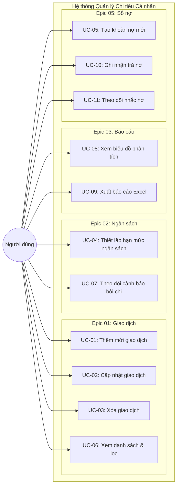
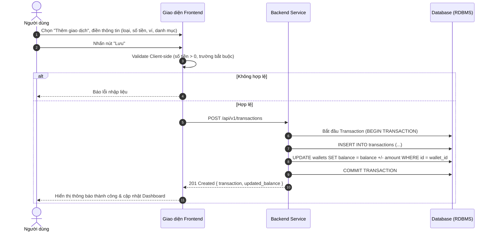

# ĐẶC TẢ CHI TIẾT USE CASE (USE CASE SPECIFICATIONS)
## HỆ THỐNG QUẢN LÝ CHI TIÊU CÁ NHÂN (QLchitieu)

---

## 1. Sơ đồ Use Case Tổng quan (Use Case Diagram)

---

## 2. Đặc tả Chi tiết các Use Case Trọng tâm

### 2.1. UC-01: Thêm mới giao dịch thu/chi

| Thuộc tính | Chi tiết đặc tả |
| :--- | :--- |
| **Mã Use Case** | **UC-01** |
| **Tên Use Case** | Thêm mới giao dịch thu / chi |
| **Tác nhân chính** | Người dùng đã xác thực (User) |
| **Mô tả** | Người dùng nhập và lưu một giao dịch thu nhập hoặc chi tiêu mới vào hệ thống. |
| **Điều kiện tiên quyết** | 1. Người dùng đã đăng nhập vào hệ thống. 2. Người dùng có ít nhất một Ví đang hoạt động. 3. Người dùng có ít nhất một Danh mục phù hợp với loại giao dịch. |
| **Hậu điều kiện** | 1. Bản ghi giao dịch mới được lưu trữ trong bảng `transactions`. 2. Số dư của ví liên quan được cộng thêm (nếu là Thu) hoặc trừ bớt (nếu là Chi). 3. Thống kê ngân sách liên quan được cập nhật tiến độ sử dụng. |
| **Luồng chính (Main Flow)** | 1. Người dùng bấm nút "+" hoặc chọn "Thêm giao dịch". 2. Hệ thống hiển thị form nhập liệu. 3. Người dùng chọn loại giao dịch (Chi tiền / Thu tiền). 4. Người dùng nhập số tiền giao dịch (> 0). 5. Người dùng chọn Danh mục chi tiêu/thu nhập. 6. Người dùng chọn Ví nguồn tiền thực hiện. 7. Người dùng chọn thời gian (mặc định là thời điểm hiện tại). 8. Người dùng nhập ghi chú và tải ảnh hóa đơn (không bắt buộc). 9. Người dùng bấm "Lưu". 10. Hệ thống xác thực tính hợp lệ của dữ liệu. 11. Hệ thống lưu bản ghi giao dịch và cập nhật số dư ví trong cùng một database transaction. 12. Hệ thống kiểm tra hạn mức ngân sách của danh mục (nếu là Chi phí). 13. Hệ thống trả về thông báo "Thêm giao dịch thành công" và làm mới dữ liệu màn hình chính. |
| **Luồng phụ / Ngoại lệ** | - **E1 - Số tiền không hợp lệ:** Người dùng để trống số tiền hoặc nhập giá trị ≤ 0 -> Hệ thống hiển thị cảnh báo đỏ *"Số tiền phải lớn hơn 0"*, nút "Lưu" bị vô hiệu hóa. - **E2 - Thiếu danh mục hoặc ví:** Người dùng chưa chọn ví hoặc danh mục -> Hệ thống tô đỏ trường còn thiếu và thông báo *"Vui lòng chọn ví/danh mục"*. |

---

### 2.2. UC-02: Cập nhật giao dịch

| Thuộc tính | Chi tiết đặc tả |
| :--- | :--- |
| **Mã Use Case** | **UC-02** |
| **Tên Use Case** | Cập nhật thông tin giao dịch |
| **Tác nhân chính** | Người dùng (User) |
| **Mô tả** | Người dùng chỉnh sửa thông tin giao dịch đã ghi nhận trước đó. |
| **Điều kiện tiên quyết** | Giao dịch cần sửa thuộc quyền sở hữu của người dùng đang đăng nhập. |
| **Hậu điều kiện** | Dữ liệu giao dịch được cập nhật; số dư ví cũ/mới được điều chỉnh bù trừ chuẩn xác. |
| **Luồng chính (Main Flow)** | 1. Người dùng chọn một giao dịch từ danh sách lịch sử. 2. Hệ thống hiển thị màn hình chi tiết và cho phép chỉnh sửa. 3. Người dùng thay đổi thông tin (Số tiền, Ví, Danh mục, Ghi chú,...). 4. Người dùng bấm "Cập nhật". 5. Hệ thống kiểm tra hợp lệ và mở transaction CSDL: &nbsp;&nbsp;&nbsp;&nbsp;a. Hoàn lại số dư ví theo số tiền và loại của giao dịch cũ. &nbsp;&nbsp;&nbsp;&nbsp;b. Áp dụng số tiền và loại mới vào ví mới được chọn. &nbsp;&nbsp;&nbsp;&nbsp;c. Cập nhật bản ghi `transactions`. 6. Hoàn tất cập nhật và hiển thị thông báo thành công. |
| **Luồng phụ / Ngoại lệ** | - Người dùng nhập số tiền mới ≤ 0 -> Báo lỗi và từ chối cập nhật. - Người dùng bấm "Hủy" -> Giữ nguyên dữ liệu cũ. |

---

### 2.3. UC-03: Xóa giao dịch

| Thuộc tính | Chi tiết đặc tả |
| :--- | :--- |
| **Mã Use Case** | **UC-03** |
| **Tên Use Case** | Xóa giao dịch |
| **Tác nhân chính** | Người dùng (User) |
| **Mô tả** | Loại bỏ hoàn toàn một giao dịch ghi nhận sai hoặc trùng lặp. |
| **Điều kiện tiên quyết** | Giao dịch tồn tại trên hệ thống. |
| **Hậu điều kiện** | Bản ghi giao dịch bị xóa; số dư ví nguồn được hoàn lại nguyên trạng. |
| **Luồng chính (Main Flow)** | 1. Người dùng bấm nút "Xóa" tại màn hình chi tiết giao dịch. 2. Hệ thống hiển thị Modal xác nhận cảnh báo: *"Thao tác này sẽ hoàn tác số dư ví. Bạn có chắc chắn muốn xóa không?"* 3. Người dùng chọn "Xác nhận xóa". 4. Hệ thống thực hiện hoàn tác số dư ví: &nbsp;&nbsp;&nbsp;&nbsp;- Nếu là Chi tiêu: Cộng lại số tiền vào ví. &nbsp;&nbsp;&nbsp;&nbsp;- Nếu là Thu nhập: Trừ bớt số tiền khỏi ví. 5. Hệ thống xóa bản ghi khỏi bảng `transactions`. 6. Đóng modal và hiển thị thông báo "Đã xóa giao dịch". |
| **Luồng phụ** | - Người dùng chọn "Hủy bỏ" tại bước 3 -> Modal đóng lại, dữ liệu được giữ nguyên vẹn. |

---

### 2.4. UC-04: Thiết lập hạn mức ngân sách

| Thuộc tính | Chi tiết đặc tả |
| :--- | :--- |
| **Mã Use Case** | **UC-04** |
| **Tên Use Case** | Thiết lập hạn mức ngân sách |
| **Tác nhân chính** | Người dùng (User) |
| **Mô tả** | Định mức số tiền chi tiêu tối đa cho một danh mục trong một tháng dương lịch. |
| **Điều kiện tiên quyết** | Người dùng đã tạo danh mục chi tiêu cần đặt hạn mức. |
| **Hậu điều kiện** | Bản ghi ngân sách được lưu hoặc cập nhật trong bảng `budgets`. |
| **Luồng chính (Main Flow)** | 1. Người dùng truy cập phân hệ "Ngân sách" và chọn "Tạo ngân sách mới". 2. Người dùng chọn Danh mục chi tiêu áp dụng. 3. Người dùng nhập Số tiền hạn mức mong muốn (> 0). 4. Người dùng chọn kỳ áp dụng (Tháng / Năm). Mặc định là tháng hiện tại. 5. Người dùng bấm "Lưu". 6. Hệ thống kiểm tra nếu đã tồn tại ngân sách của danh mục này trong tháng thì thực hiện cập nhật (`UPSERT`), nếu chưa thì tạo mới. 7. Hệ thống tính toán ngay tỷ lệ % đã chi từ các giao dịch trong tháng đó. 8. Hiển thị thông báo "Thiết lập ngân sách thành công". |
| **Luồng phụ / Ngoại lệ** | - Người dùng nhập số tiền ≤ 0 -> Báo lỗi *"Số tiền hạn mức phải lớn hơn 0"*. |

---

### 2.5. UC-05: Tạo khoản nợ mới (Sổ nợ)

| Thuộc tính | Chi tiết đặc tả |
| :--- | :--- |
| **Mã Use Case** | **UC-05** |
| **Tên Use Case** | Tạo khoản nợ mới (Vay / Cho vay) |
| **Tác nhân chính** | Người dùng (User) |
| **Mô tả** | Ghi nhận một khoản nợ phát sinh khi người dùng đi vay tiền hoặc cho người khác mượn tiền. |
| **Điều kiện tiên quyết** | Người dùng có ví khả dụng để nhận/chuyển tiền. |
| **Hậu điều kiện** | 1. Bản ghi khoản nợ mới được tạo trong bảng `debts` với `remaining = amount`. 2. Số dư ví được biến động theo nghiệp vụ. |
| **Luồng chính (Main Flow)** | 1. Người dùng vào màn hình Sổ nợ, bấm "Thêm khoản nợ". 2. Chọn loại hình: **Đi vay** (Borrow) hoặc **Cho vay** (Lend). 3. Nhập số tiền vay ban đầu (> 0). 4. Nhập tên người vay/cho vay (Đối tác). 5. Chọn ngày hẹn hoàn trả (Due Date). 6. Chọn Ví thực hiện giao dịch. 7. Nhập ghi chú (nếu có). 8. Bấm "Lưu". 9. Hệ thống kiểm tra hợp lệ: &nbsp;&nbsp;&nbsp;&nbsp;- Nếu là "Cho vay": Trừ tiền trong ví được chọn. &nbsp;&nbsp;&nbsp;&nbsp;- Nếu là "Đi vay": Cộng tiền vào ví được chọn. 10. Lưu bản ghi nợ với trạng thái mặc định là `unpaid`. 11. Hiển thị thông báo thành công. |
| **Luồng phụ / Ngoại lệ** | - Bỏ trống tên người liên quan hoặc số tiền -> Hệ thống yêu cầu điền đầy đủ. |
