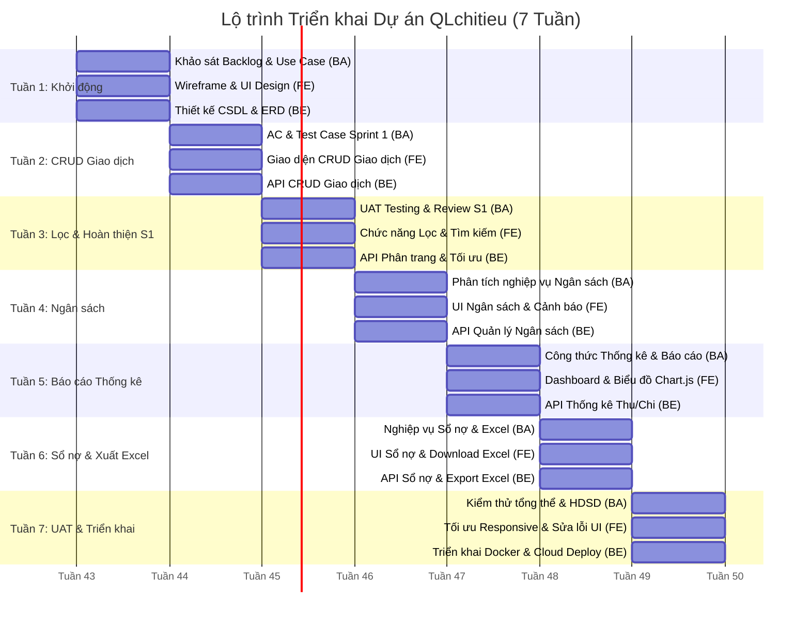

# KẾ HOẠCH PHÂN CÔNG NHIỆM VỤ DỰ ÁN (PROJECT TIMELINE & ROLES)
## HỆ THỐNG QUẢN LÝ CHI TIÊU CÁ NHÂN (QLchitieu)

> **Tham chiếu Google Sheet:** `N4_QLchitieu` (Sheet: *nhiệm vụ*)  
> **Cơ cấu đội ngũ thực hiện:**
> 1. **Business Analyst (BA) + Scrum Master**
> 2. **Frontend Developer (UI/UX & Client)**
> 3. **Backend Developer + Database + Testing**

---

## 1. Ma trận Trách nhiệm Tổng thể theo Tuần (RACI Matrix & Roadmap)

---

## 2. Bảng Phân công Nhiệm vụ Chi tiết (Từ Tuần 1 đến Tuần 7)

| Tuần | Vai trò | Nhiệm vụ chính | Công cụ sử dụng | Kỹ năng cần nắm | Sản phẩm đầu ra | Lưu ý chất lượng |
| :---: | :--- | :--- | :--- | :--- | :--- | :--- |
| **1.0** | **BA / Scrum Master** | Phân tích Product Backlog, User Story, xác định phạm vi MVP, lập Sprint Plan | Trello, Jira, Draw.io | Scrum, User Story, Use Case | Product Backlog hoàn chỉnh, Sprint Plan, Use Case Diagram | Chốt yêu cầu rõ ràng trước khi lập trình |
| | **Frontend Developer** | Thiết kế Wireframe và UI các màn hình chính | Figma | UI/UX, Responsive Design | Wireframe, Mockup Dashboard, Giao dịch, Ngân sách | Thống nhất bảng màu thương hiệu và design token |
| | **Backend Developer** | Thiết kế CSDL, ERD, thiết lập môi trường backend | MySQL, Spring Boot / NodeJS | Database Design, REST API | ERD, Database Schema DDL | Chuẩn hóa tên bảng, trường và ràng buộc toàn vẹn |
| **2.0** | **BA / Scrum Master** | Viết Acceptance Criteria, Test Cases cho chức năng giao dịch | Excel, Word | Test Case Design | Bộ Test Case Sprint 1 | Kiểm tra đầy đủ luồng nghiệp vụ chính & ngoại lệ |
| | **Frontend Developer** | Tạo giao diện CRUD giao dịch | ReactJS / VueJS | Form Validation, React Hooks | Màn hình Thêm / Sửa / Xóa giao dịch | Bảo đảm dễ thao tác bàn phím ảo trên điện thoại |
| | **Backend Developer** | Xây dựng API CRUD giao dịch | Postman, Spring Boot / NodeJS | RESTful API, CRUD | Bộ API Transaction hoàn chỉnh | Kiểm tra xác thực dữ liệu đầu vào nghiêm ngặt |
| **3.0** | **BA / Scrum Master** | Kiểm thử chức năng giao dịch, đánh giá Sprint Review | Postman, Excel | UAT Testing | Báo cáo Sprint 1 Review | Xác nhận nghiệm thu đúng yêu cầu người dùng |
| | **Frontend Developer** | Tạo chức năng lọc, tìm kiếm giao dịch | ReactJS | State Management | Trang lịch sử giao dịch hoàn chỉnh | Tối ưu tốc độ hiển thị và trải nghiệm cuộn mượt |
| | **Backend Developer** | Hoàn thiện API tìm kiếm, phân trang | Postman | Pagination, Query Optimization | API Search, API Filter | Kiểm tra hiệu năng khi dữ liệu đạt hàng ngàn bản ghi |
| **4.0** | **BA / Scrum Master** | Phân tích nghiệp vụ quản lý ngân sách | Excel | Personal Finance Budgeting | Tài liệu Budget Feature | Làm rõ quy tắc đổi màu và các ngưỡng cảnh báo |
| | **Frontend Developer** | Thiết kế giao diện ngân sách và cảnh báo | ReactJS, TailwindCSS / MUI | Chart & Progress Bar | Màn hình Ngân sách | Thiết kế trực quan, đổi màu Xanh / Vàng / Đỏ linh hoạt |
| | **Backend Developer** | Xây dựng API quản lý ngân sách | Spring Boot / NodeJS | Business Logic | API Budget Management | Tránh tính sai phần trăm lũy kế chi tiêu |
| **5.0** | **BA / Scrum Master** | Xác nhận công thức thống kê, báo cáo | Excel | Data Analysis | Tài liệu nghiệp vụ Thống kê | Kiểm tra đối soát độ chính xác của số liệu |
| | **Frontend Developer** | Xây dựng Dashboard và biểu đồ | ChartJS / ApexCharts | Data Visualization | Dashboard thống kê trực quan | Phân bổ màu sắc rõ ràng, dễ hiểu |
| | **Backend Developer** | Xây dựng API thống kê thu chi | SQL, Postman | Aggregate Functions | API Reports | Tối ưu câu lệnh GROUP BY và tính toán nhanh |
| **6.0** | **BA / Scrum Master** | Phân tích chức năng sổ nợ và xuất báo cáo | Excel | Debt Management | Đặc tả chức năng Sổ nợ | Đảm bảo nghiệp vụ phù hợp với thực tế đời sống |
| | **Frontend Developer** | Thiết kế giao diện quản lý nợ và xuất Excel | ReactJS | File Download | Màn hình Sổ nợ & Nút tải Excel | Kiểm tra hiển thị tốt danh sách nợ dài |
| | **Backend Developer** | Xây dựng API quản lý nợ, hoàn trả nợ, xuất Excel | Spring Boot, ExcelJS / POI | Export File Streaming | API Debt, API Export Excel | Định dạng chuẩn file Excel `.xlsx`, không lỗi font |
| **7.0** | **BA / Scrum Master** | Kiểm thử tổng thể, viết báo cáo dự án | Word, Excel | UAT & Documentation | Báo cáo tổng kết dự án, Hướng dẫn sử dụng | Nghiệm thu toàn bộ 17 User Story trong Backlog |
| | **Frontend Developer** | Tối ưu Responsive, sửa lỗi UI | Chrome DevTools | Frontend Optimization | Ứng dụng Web UI hoàn thiện | Kiểm thử đa trình duyệt và độ phân giải màn hình |
| | **Backend Developer** | Deploy hệ thống, sửa lỗi còn lại | Docker, Railway, Render | DevOps cơ bản | Hệ thống production chạy thực tế | Sao lưu dữ liệu CSDL an toàn trước khi deploy |
