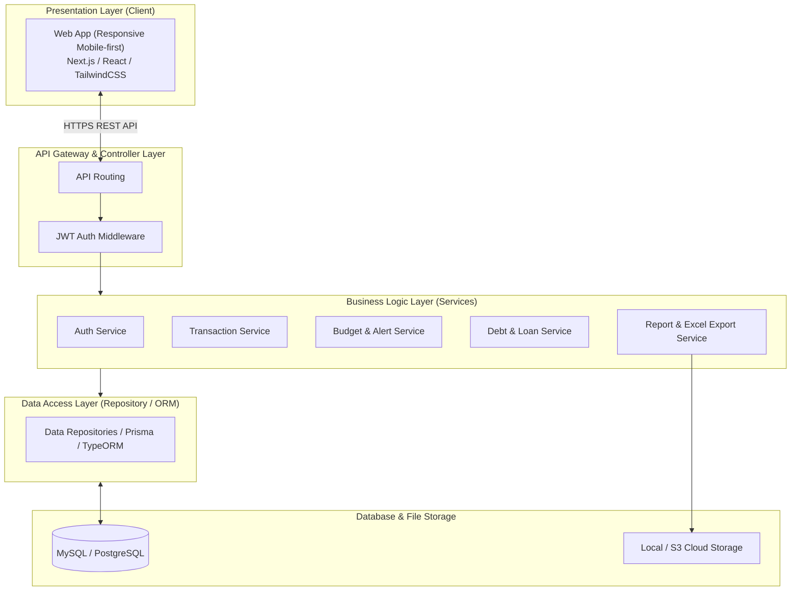

# ĐẶC TẢ KIẾN TRÚC & RESTFUL API
## HỆ THỐNG QUẢN LÝ CHI TIÊU CÁ NHÂN (QLchitieu)

---

## 1. Kiến trúc Hệ thống (System Architecture)

Hệ thống được thiết kế theo mô hình phân tầng chuẩn mực (**Layered Architecture**):



---

## 2. Quy chuẩn Thiết kế API (API Standards)

- **Định dạng dữ liệu:** Toàn bộ payload trao đổi qua JSON (`Content-Type: application/json; charset=utf-8`).
- **Base URL:** `https://api.qlchitieu.vn/api/v1`
- **Xác thực người dùng:** Bearer Token qua Header:
  ```http
  Authorization: Bearer <jwt_access_token>
  ```
- **Quy chuẩn mã phản hồi (HTTP Status Codes):**
  - `200 OK`: Yêu cầu thành công, có dữ liệu trả về.
  - `201 Created`: Tạo mới bản ghi thành công.
  - `204 No Content`: Xóa hoặc cập nhật thành công, không trả nội dung.
  - `400 Bad Request`: Lỗi dữ liệu đầu vào không hợp lệ.
  - `401 Unauthorized`: Chưa đăng nhập hoặc token hết hạn.
  - `403 Forbidden`: Không có quyền truy cập dữ liệu của người dùng khác.
  - `404 Not Found`: Không tìm thấy bản ghi.
  - `500 Internal Server Error`: Lỗi hệ thống nội bộ.

- **Cấu trúc JSON phản hồi chuẩn:**
  ```json
  {
    "success": true,
    "message": "Thông điệp xử lý",
    "data": {},
    "errors": null
  }
  ```

---

## 3. Danh sách Endpoints RESTful API

### 3.1. Xác thực & Tài khoản (Authentication)

| Method | Endpoint | Mô tả |
| :--- | :--- | :--- |
| `POST` | `/auth/register` | Đăng ký tài khoản người dùng mới |
| `POST` | `/auth/login` | Đăng nhập và nhận JWT token |
| `GET` | `/auth/profile` | Lấy thông tin tài khoản hiện tại |

### 3.2. Quản lý Ví (Wallets)

| Method | Endpoint | Mô tả |
| :--- | :--- | :--- |
| `GET` | `/wallets` | Lấy danh sách ví và tổng số dư tài chính |
| `POST` | `/wallets` | Tạo ví mới (Tiền mặt, Ngân hàng, Ví điện tử) |
| `GET` | `/wallets/:id` | Xem chi tiết thông tin ví |
| `PUT` | `/wallets/:id` | Cập nhật thông tin ví (Tên, màu, loại) |
| `DELETE` | `/wallets/:id` | Xóa ví (nếu chưa có giao dịch ràng buộc) |

### 3.3. Quản lý Danh mục (Categories)

| Method | Endpoint | Mô tả |
| :--- | :--- | :--- |
| `GET` | `/categories` | Lấy cây danh mục thu/chi (kèm danh mục con) |
| `POST` | `/categories` | Tạo mới danh mục |
| `PUT` | `/categories/:id` | Cập nhật tên, icon, màu, cha - con |
| `DELETE` | `/categories/:id` | Xóa danh mục (yêu cầu chuyển giao dịch cũ) |

### 3.4. Quản lý Giao dịch (Transactions)

| Method | Endpoint | Mô tả | Query Parameters |
| :--- | :--- | :--- | :--- |
| `GET` | `/transactions` | Danh sách lịch sử giao dịch | `page`, `limit`, `wallet_id`, `category_id`, `from_date`, `to_date`, `type`, `search` |
| `POST` | `/transactions` | Tạo mới giao dịch thu/chi | – |
| `GET` | `/transactions/:id` | Xem chi tiết 1 giao dịch | – |
| `PUT` | `/transactions/:id` | Sửa thông tin giao dịch | – |
| `DELETE` | `/transactions/:id`| Xóa giao dịch (hoàn lại tiền ví) | – |

#### Ví dụ Body: Thêm mới giao dịch (`POST /transactions`)
```json
{
  "wallet_id": 1,
  "category_id": 5,
  "type": "expense",
  "amount": 150000,
  "note": "Ăn trưa với đồng nghiệp",
  "image_url": "https://storage.qlchitieu.vn/bills/img_01.jpg",
  "transaction_date": "2026-11-08T12:30:00Z"
}
```

### 3.5. Quản lý Ngân sách (Budgets)

| Method | Endpoint | Mô tả |
| :--- | :--- | :--- |
| `GET` | `/budgets` | Lấy danh sách ngân sách tháng (`month`, `year`) kèm % tiến độ |
| `POST` | `/budgets` | Thiết lập hạn mức ngân sách cho danh mục |
| `PUT` | `/budgets/:id` | Chỉnh sửa số tiền hạn mức |
| `DELETE` | `/budgets/:id` | Hủy bỏ hạn mức ngân sách |

### 3.6. Quản lý Sổ nợ (Debts & Loans)

| Method | Endpoint | Mô tả |
| :--- | :--- | :--- |
| `GET` | `/debts` | Danh sách khoản nợ (lọc theo `status`: `unpaid`, `completed`, `overdue`) |
| `POST` | `/debts` | Tạo khoản nợ mới (Vay hoặc Cho vay) |
| `GET` | `/debts/:id` | Chi tiết khoản nợ và lịch sử các đợt trả |
| `POST` | `/debts/:id/payments` | Ghi nhận thanh toán trả nợ một phần hoặc tất toán |

#### Ví dụ Body: Ghi nhận trả nợ (`POST /debts/:id/payments`)
```json
{
  "wallet_id": 1,
  "amount": 500000,
  "note": "Thanh toán đợt 1",
  "paid_at": "2026-11-08T15:00:00Z"
}
```

### 3.7. Báo cáo & Thống kê (Reports & Export)

| Method | Endpoint | Mô tả |
| :--- | :--- | :--- |
| `GET` | `/reports/category-pie` | Dữ liệu tỷ trọng chi tiêu tròn theo danh mục (`from_date`, `to_date`) |
| `GET` | `/reports/income-vs-expense` | Dữ liệu biểu đồ cột so sánh Thu và Chi theo 12 tháng trong năm (`year`) |
| `GET` | `/reports/export-excel` | Tải về file `.xlsx` danh sách giao dịch |
