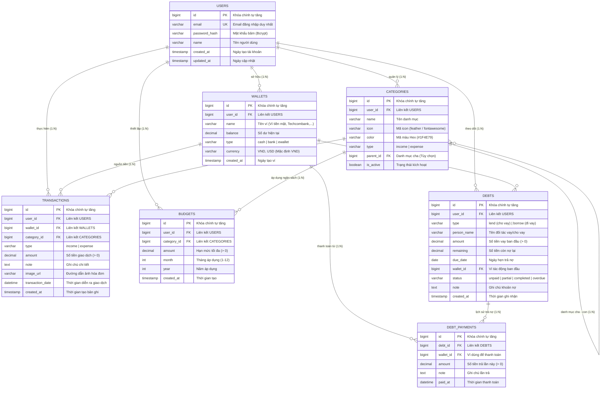

# THIẾT KẾ CƠ SỞ DỮ LIỆU (DATABASE DESIGN)
## DỰ ÁN: QUẢN LÝ CHI TIÊU CÁ NHÂN (QLchitieu)

---

## 1. Sơ đồ Thực thể Liên kết (Entity Relationship Diagram - ERD)

---

## 2. Từ điển Dữ liệu Chi tiết (Data Dictionary)

### 2.1. Bảng `users` (Người dùng)
Lưu thông tin định danh và tài khoản người sử dụng.

| Tên trường | Kiểu dữ liệu | Nullable | Mặc định | Ràng buộc / Mô tả |
| :--- | :--- | :---: | :--- | :--- |
| `id` | `BIGINT` | NO | Auto Increment | **PRIMARY KEY** |
| `email` | `VARCHAR(191)` | NO | | **UNIQUE**, Email đăng nhập hợp lệ |
| `password_hash` | `VARCHAR(255)` | NO | | Mật khẩu đã được mã hóa Bcrypt/Argon2 |
| `name` | `VARCHAR(100)` | NO | | Họ tên hiển thị của người dùng |
| `created_at` | `TIMESTAMP` | NO | `CURRENT_TIMESTAMP` | Thời điểm tạo tài khoản |
| `updated_at` | `TIMESTAMP` | YES | `CURRENT_TIMESTAMP ON UPDATE` | Thời điểm cập nhật cuối |

---

### 2.2. Bảng `wallets` (Ví nguồn tiền)
Lưu trữ các nguồn tài chính khác nhau của người dùng (tiền mặt, thẻ ngân hàng, ví Momo,...).

| Tên trường | Kiểu dữ liệu | Nullable | Mặc định | Ràng buộc / Mô tả |
| :--- | :--- | :---: | :--- | :--- |
| `id` | `BIGINT` | NO | Auto Increment | **PRIMARY KEY** |
| `user_id` | `BIGINT` | NO | | **FOREIGN KEY** (`users.id`) ON DELETE CASCADE |
| `name` | `VARCHAR(100)` | NO | | Tên ví (VD: Tiền mặt, Vietcombank) |
| `balance` | `DECIMAL(15, 2)`| NO | `0.00` | Số dư khả dụng hiện tại |
| `type` | `VARCHAR(20)` | NO | `'cash'` | Enum: `cash`, `bank`, `ewallet` |
| `currency` | `VARCHAR(10)` | NO | `'VND'` | Đơn vị tiền tệ (VND, USD) |
| `created_at` | `TIMESTAMP` | NO | `CURRENT_TIMESTAMP` | Thời điểm tạo ví |

---

### 2.3. Bảng `categories` (Danh mục Thu / Chi)
Lưu trữ danh mục phân loại chi tiêu và thu nhập, hỗ trợ quan hệ danh mục cha - con.

| Tên trường | Kiểu dữ liệu | Nullable | Mặc định | Ràng buộc / Mô tả |
| :--- | :--- | :---: | :--- | :--- |
| `id` | `BIGINT` | NO | Auto Increment | **PRIMARY KEY** |
| `user_id` | `BIGINT` | NO | | **FOREIGN KEY** (`users.id`) ON DELETE CASCADE |
| `name` | `VARCHAR(100)` | NO | | Tên danh mục (VD: Ăn uống, Tiền lương) |
| `icon` | `VARCHAR(50)` | YES | NULL | Tên định danh biểu tượng giao diện |
| `color` | `VARCHAR(20)` | YES | `'#1F4E79'` | Mã màu hiển thị (Hex code) |
| `type` | `VARCHAR(20)` | NO | | Enum: `income` (Thu) hoặc `expense` (Chi) |
| `parent_id` | `BIGINT` | YES | NULL | **FOREIGN KEY** (`categories.id`) ON DELETE SET NULL |
| `is_active` | `BOOLEAN` | NO | `TRUE` | Trạng thái hiển thị / ẩn danh mục |

---

### 2.4. Bảng `transactions` (Giao dịch thu chi)
Bảng chứa dữ liệu các giao dịch thu vào hoặc chi ra của người dùng.

| Tên trường | Kiểu dữ liệu | Nullable | Mặc định | Ràng buộc / Mô tả |
| :--- | :--- | :---: | :--- | :--- |
| `id` | `BIGINT` | NO | Auto Increment | **PRIMARY KEY** |
| `user_id` | `BIGINT` | NO | | **FOREIGN KEY** (`users.id`) ON DELETE CASCADE |
| `wallet_id` | `BIGINT` | NO | | **FOREIGN KEY** (`wallets.id`) ON DELETE RESTRICT |
| `category_id` | `BIGINT` | NO | | **FOREIGN KEY** (`categories.id`) ON DELETE RESTRICT |
| `type` | `VARCHAR(20)` | NO | | Enum: `income` hoặc `expense` |
| `amount` | `DECIMAL(15, 2)`| NO | | Số tiền giao dịch; ràng buộc `amount > 0` |
| `note` | `TEXT` | YES | NULL | Ghi chú thêm cho giao dịch |
| `image_url` | `VARCHAR(500)` | YES | NULL | URL ảnh hóa đơn/chứng từ |
| `transaction_date`| `DATETIME` | NO | | Thời điểm giao dịch phát sinh |
| `created_at` | `TIMESTAMP` | NO | `CURRENT_TIMESTAMP` | Thời điểm ghi bản ghi |

---

### 2.5. Bảng `budgets` (Hạn mức ngân sách)
Quản lý hạn mức chi tiêu tối đa cho một danh mục trong tháng nhất định.

| Tên trường | Kiểu dữ liệu | Nullable | Mặc định | Ràng buộc / Mô tả |
| :--- | :--- | :---: | :--- | :--- |
| `id` | `BIGINT` | NO | Auto Increment | **PRIMARY KEY** |
| `user_id` | `BIGINT` | NO | | **FOREIGN KEY** (`users.id`) ON DELETE CASCADE |
| `category_id` | `BIGINT` | NO | | **FOREIGN KEY** (`categories.id`) ON DELETE CASCADE |
| `amount` | `DECIMAL(15, 2)`| NO | | Hạn mức chi tiêu tối đa (> 0) |
| `month` | `INT` | NO | | Tháng áp dụng (1 - 12) |
| `year` | `INT` | NO | | Năm áp dụng (VD: 2026) |
| `created_at` | `TIMESTAMP` | NO | `CURRENT_TIMESTAMP` | Thời gian tạo thiết lập |

> **Ràng buộc duy nhất:** `UNIQUE KEY uk_user_category_month_year (user_id, category_id, month, year)` tránh trùng lặp ngân sách.

---

### 2.6. Bảng `debts` (Hồ sơ vay / Sổ nợ)
Lưu thông tin các khoản vay mình nợ người khác hoặc người khác nợ mình.

| Tên trường | Kiểu dữ liệu | Nullable | Mặc định | Ràng buộc / Mô tả |
| :--- | :--- | :---: | :--- | :--- |
| `id` | `BIGINT` | NO | Auto Increment | **PRIMARY KEY** |
| `user_id` | `BIGINT` | NO | | **FOREIGN KEY** (`users.id`) ON DELETE CASCADE |
| `wallet_id` | `BIGINT` | NO | | **FOREIGN KEY** (`wallets.id`) Ví nguồn tiền tác động |
| `type` | `VARCHAR(20)` | NO | | Enum: `lend` (Cho vay) hoặc `borrow` (Đi vay) |
| `person_name` | `VARCHAR(100)` | NO | | Họ tên người liên quan |
| `amount` | `DECIMAL(15, 2)`| NO | | Tổng số tiền vay ban đầu (> 0) |
| `remaining` | `DECIMAL(15, 2)`| NO | | Số nợ còn lại chưa trả |
| `due_date` | `DATE` | YES | NULL | Hạn thanh toán |
| `status` | `VARCHAR(20)` | NO | `'unpaid'` | Enum: `unpaid`, `partial`, `completed`, `overdue` |
| `note` | `TEXT` | YES | NULL | Ghi chú khoản vay |
| `created_at` | `TIMESTAMP` | NO | `CURRENT_TIMESTAMP` | Ngày tạo bản ghi |

---

### 2.7. Bảng `debt_payments` (Lịch sử trả nợ)
Ghi nhận từng lần hoàn trả nợ cho một khoản vay cụ thể.

| Tên trường | Kiểu dữ liệu | Nullable | Mặc định | Ràng buộc / Mô tả |
| :--- | :--- | :---: | :--- | :--- |
| `id` | `BIGINT` | NO | Auto Increment | **PRIMARY KEY** |
| `debt_id` | `BIGINT` | NO | | **FOREIGN KEY** (`debts.id`) ON DELETE CASCADE |
| `wallet_id` | `BIGINT` | NO | | **FOREIGN KEY** (`wallets.id`) Ví thực hiện giao dịch trả nợ |
| `amount` | `DECIMAL(15, 2)`| NO | | Số tiền thanh toán lần này (> 0) |
| `note` | `VARCHAR(255)` | YES | NULL | Ghi chú thanh toán |
| `paid_at` | `DATETIME` | NO | `CURRENT_TIMESTAMP` | Thời điểm thanh toán |

---

## 3. Chiến lược Đánh chỉ mục (Indexing Strategy)

Để đảm bảo yêu cầu phi chức năng **NFR-01** (tải danh sách giao dịch ≤ 2.0 giây trên 1.000 bản ghi), các chỉ mục sau được thiết lập:

1. **`transactions`:**
   - `idx_transactions_user_date (user_id, transaction_date DESC)`: Tối ưu hóa truy vấn dòng thời gian và lọc theo khoảng thời gian.
   - `idx_transactions_category (category_id)`: Tối ưu hóa thống kê chi tiêu theo danh mục.
   - `idx_transactions_wallet (wallet_id)`: Tối ưu tính toán số dư theo ví.
2. **`budgets`:**
   - `idx_budgets_user_period (user_id, month, year)`: Truy xuất danh sách ngân sách tháng hiện tại tức thì.
3. **`debts`:**
   - `idx_debts_user_status (user_id, status)`: Tối ưu chuyển đổi tab Chưa thanh toán / Quá hạn / Đã tất toán.
   - `idx_debts_due_date (due_date)`: Hỗ trợ tác vụ quét lịch nhắc nợ định kỳ.
