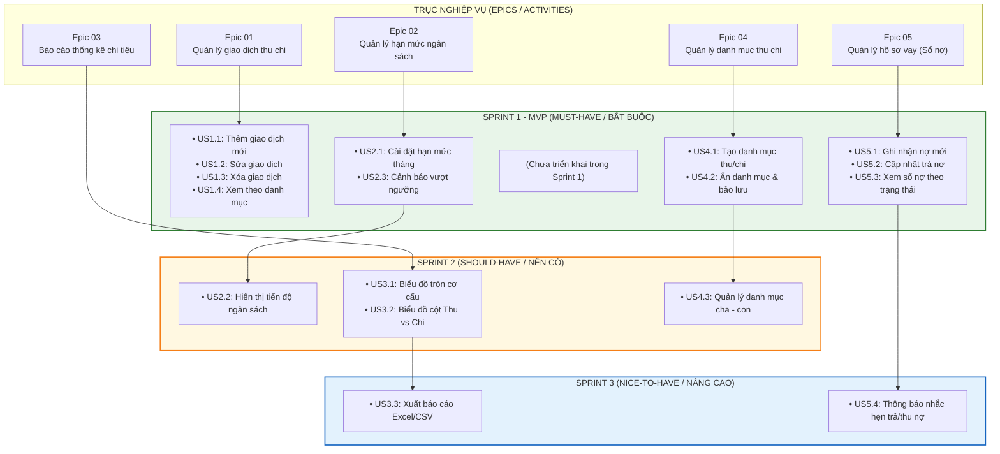

# BẢN ĐỒ CÂU CHUYỆN NGƯỜI DÙNG (USER STORY MAP)
## DỰ ÁN: QUẢN LÝ CHI TIÊU CÁ NHÂN (QLchitieu)

> **Tham chiếu Google Sheet:** `N4_QLchitieu` (Sheet: *map*)  
> **Nguyên tắc phân loại:** MoSCoW (Must-Have, Should-Have, Nice-to-Have) kết hợp phân kỳ Sprint (Sprint 1, Sprint 2, Sprint 3).

---

## 1. Ma trận Trực quan User Story Map

---

## 2. Bảng Ma trận Chi tiết theo Mức độ Ưu tiên

| Mức ưu tiên | Sprint | Epic 01: Quản lý giao dịch thu chi | Epic 02: Quản lý hạn mức ngân sách | Epic 03: Báo cáo thống kê chi tiêu | Epic 04: Quản lý danh mục thu chi | Epic 05: Quản lý hồ sơ vay |
| :--- | :---: | :--- | :--- | :--- | :--- | :--- |
| **Must-Have** *(Cốt lõi - Bắt buộc cho MVP)* | **Sprint 1** | - **US1.1:** Thêm giao dịch mới - **US1.2:** Sửa giao dịch - **US1.3:** Xóa giao dịch - **US1.4:** Xem theo danh mục | - **US2.1:** Cài đặt hạn mức ngân sách tháng - **US2.3:** Cảnh báo khi vượt ngưỡng ngân sách | *(Triển khai ở Sprint 2)* | - **US4.1:** Tạo danh mục thu/chi - **US4.2:** Ẩn danh mục & bảo lưu dữ liệu | - **US5.1:** Ghi nhận khoản nợ mới (Vay/Cho vay) - **US5.2:** Cập nhật trả nợ - **US5.3:** Xem danh sách sổ nợ theo trạng thái |
| **Should-Have** *(Quan trọng - Tăng trải nghiệm)* | **Sprint 2** | | - **US2.2:** Hiển thị thanh tiến độ sử dụng ngân sách | - **US3.1:** Biểu đồ tròn phân bổ chi tiêu - **US3.2:** Biểu đồ cột so sánh Thu vs Chi | - **US4.3:** Quản lý danh mục cha - con | |
| **Nice to Have** *(Giá trị gia tăng - Tùy chọn)* | **Sprint 3** | | | - **US3.3:** Xuất dữ liệu báo cáo ra Excel/CSV | | - **US5.4:** Thông báo nhắc hẹn trả/thu hồi nợ |

---

## 3. Chiến lược phát hành sản phẩm (Release Strategy)

1. **Bản phát hành Release 1 (End of Sprint 1 - Core MVP):**
   - Đảm bảo người dùng có thể thực hiện toàn bộ chu trình cốt lõi: Tạo tài khoản, tạo danh mục chi tiêu, ghi nhận thu/chi, thiết lập hạn mức cơ bản và ghi nhận các khoản vay nợ.
2. **Bản phát hành Release 2 (End of Sprint 2 - Analytics & Optimization):**
   - Bổ sung thanh tiến độ trực quan cho ngân sách, cây danh mục cha - con và hệ thống báo cáo biểu đồ trực quan hóa dữ liệu thu/chi.
3. **Bản phát hành Release 3 (End of Sprint 3 - Automation & Export):**
   - Hoàn thiện xuất file Excel phục vụ lưu trữ chuyên sâu và hệ thống tự động quét lịch gửi thông báo nhắc hẹn công nợ.
